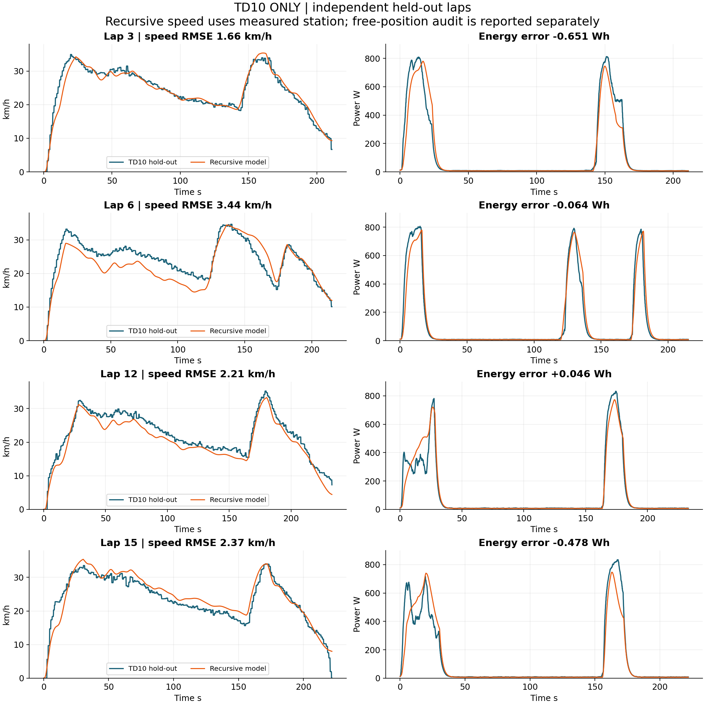
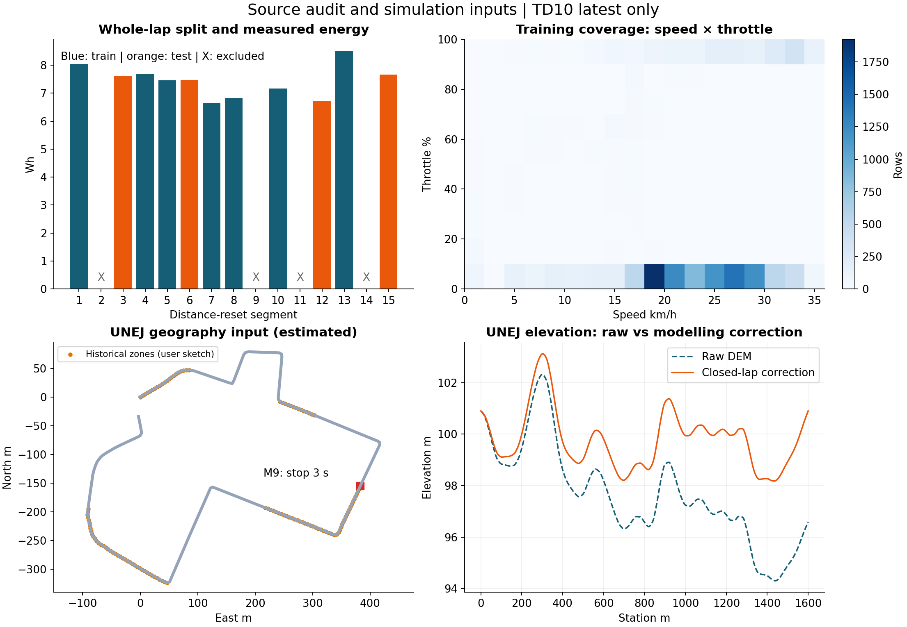

# RAKATA Urban — Vehicle Telemetry, Driver Simulation & Vehicle Modelling

An independent engineering software project developed for the **RAKATA Urban Concept Electric Vehicle** in the context of **Kontes Mobil Hemat Energi (KMHE) 2026** at Institut Teknologi Bandung.

This repository brings together three related but separately implemented engineering workstreams:

1. **Vehicle telemetry and monitoring** — data acquisition, Node-RED processing, MQTT communication, and driver/paddock monitoring.
2. **Driver training and browser simulation** — a browser-based driving simulator for practicing throttle, braking, and steering strategies.
3. **Vehicle modelling and analysis** — telemetry-driven vehicle modelling, calibration, and validation workflows using MATLAB/Simulink and supporting scripts.

> **Development ownership:** I independently designed and developed the software systems documented in this repository, including the telemetry flows, dashboards, browser simulator, modelling workflow, and supporting tools. No other software developer contributed to the implementation of these systems. The RAKATA / KMHE references describe the project context; they do not imply that I authored the vehicle hardware, competition rules, or third-party libraries.

---

## My role and contribution

I was the **sole developer** of the software systems in this repository. My responsibilities covered the full software workflow:

- Designing the overall system architecture and the separation between live telemetry, offline analysis, driver training, and vehicle modelling.
- Implementing the Node-RED telemetry flows, data parsing, GPS handling, and MQTT communication.
- Developing the browser-based telemetry analyzer and its data visualization workflow.
- Building the browser-based driver simulator, including vehicle-response logic, input handling, replay, and session outputs.
- Developing the MATLAB/Simulink modelling and validation workflow, including data preparation, calibration, holdout analysis, and transfer-study scripts.
- Preparing test procedures, technical notes, reports, and repository documentation.

The project is associated with the RAKATA Urban Concept EV / KMHE 2026 context. This distinction is intentional: the statement of individual ownership refers to the software and engineering systems in this repository.

---

## Project at a glance

| Workstream | What it does | Main technologies |
|---|---|---|
| Telemetry pipeline | Receives, processes, and distributes vehicle telemetry | Node-RED, TCP, MQTT, JavaScript |
| Telemetry analyzer | Imports and visualizes recorded vehicle data | HTML, CSS, JavaScript, Leaflet, Chart.js |
| Driver training simulator | Simulates driver inputs and vehicle response in a browser | JavaScript, Canvas 2D, Gamepad API |
| Vehicle modelling | Fits and evaluates vehicle-response models using track data | MATLAB, Simulink, Python verification scripts |

## Applications and documentation

| Resource | Description |
|---|---|
| [Project Hub](./index.html) | Main project landing page and technical overview |
| [Telemetry Web Analyzer](./dashboard/index.html) | Import CSV/XLSX logs, inspect lap data, compare runs, and visualize GPS tracks and time-series data |
| [Node-RED — Driver Flow](./nodered_flows/flowsUrbanHP.json) | Driver-side telemetry flow, including GPS-field handling and MQTT publishing |
| [Node-RED — Paddock Flow](./nodered_flows/flowsUrbanPaddock.json) | Paddock-side monitoring and telemetry processing flow |
| [TD12 Browser Driver Simulator](./simulator/RAKATA_KMHE_Simulator_V4_TD12/RAKATA_KMHE_TD12/RAKATA_TD10_Trainer.html) | Browser-based driver training simulator; the HTML filename is retained for launcher compatibility |
| [TD12 Simulator Guide](./simulator/RAKATA_KMHE_Simulator_V4_TD12/RAKATA_KMHE_TD12/README_TD12.md) | Instructions, controls, calibration notes, and simulator test limitations |
| [Six-Lap Attempt Simulator](./simulator/RAKATA_KMHE_Simulator_V4_TD12/RAKATA_KMHE_TD12/RAKATA_KMHE_Attempt.html) | Separate multi-lap attempt simulator for exploring energy and stop strategy |
| [TD10 MATLAB/Simulink Package](./simulator/RAKATA_KMHE_MATLAB_SIMULINK/RAKATA_TD10_ONLY/README.md) | TD10-only vehicle modelling, training, holdout evaluation, and UNEJ transfer study |
| [TD10 Validation Report](./simulator/RAKATA_KMHE_MATLAB_SIMULINK/RAKATA_TD10_ONLY/results/TD10_Audit_Validation.html) | Detailed dataset audit and model-validation report |
| [Test-Drive Procedure](./docs/How%20To%20Test%20Drive%20Urban.pdf) | Test-drive procedure and operating reference |
| [Telemetry Logic Notes](./docs/telem.logic.pdf) | Telemetry calculation and processing notes |
| [Simulator User Guide](./docs/RAKATA_Panduan_Game.md) | Additional driver-game controls and usage notes |

---

## System architecture

The repository contains related tools, but they are **not one monolithic application**. The telemetry pipeline, browser simulator, and MATLAB/Simulink modelling workflow have different execution paths.

```mermaid
flowchart TD
    subgraph LIVE[Vehicle telemetry and monitoring]
        VEH[Vehicle data source] --> NR[Node-RED acquisition and processing]
        GPS[Phone GPS source] --> NR
        NR --> MQTT[MQTT broker]
        MQTT --> DRIVER[Driver display]
        MQTT --> PADDOCK[Paddock monitoring]
    end

    subgraph OFFLINE[Recorded-data analysis]
        LOG[Recorded CSV / XLSX telemetry] --> DASH[Telemetry Web Analyzer]
        LOG --> PREP[Data audit and preprocessing]
        PREP --> MODEL[MATLAB / Simulink vehicle model]
        MODEL --> VALID[Holdout evaluation and simulation reports]
    end

    subgraph TRAINING[Driver training simulator]
        INPUT[Keyboard / gamepad input] --> SIM[Browser vehicle simulator]
        SIM --> RESULT[Training replay and exported results]
    end
```



**Important separation:** the browser-based driver simulator and the MATLAB/Simulink vehicle model are separate implementations. They share the RAKATA project context and selected vehicle/telemetry assumptions, but this repository does not claim a live software connection or automatic data exchange between them.

### 1. Vehicle telemetry and monitoring

The Node-RED flows handle telemetry processing and communication between the driver-side and paddock-side components. The active driver flow includes a TCP input, GPS-field replacement/validation logic, and MQTT publishing.

The documented 11-field telemetry payload is:

```text
lat,lng,speed,sat,throttle,current_mA,voltage,power,energy,distance,millis
```

The flow uses phone GPS values for latitude, longitude, and speed when a fresh GPS fix is available. A GPS fix older than 15 seconds is treated as stale by the relevant flow logic. The MQTT payload field order is kept unchanged so that downstream processing can continue to use the same schema.

The telemetry analyzer is a separate offline analysis interface. It reads imported CSV/XLSX logs and provides tools for reviewing lap segments, speed, electrical data, throttle, and GPS track visualizations. It should not be described as an MQTT client unless a direct MQTT feature is added and verified.

### 2. Browser-based driver training simulator

The TD12 training package provides a browser-based environment for practicing driver input and reviewing simulated vehicle behavior. The documented features include:

- Manual driving and assisted-steering modes.
- Keyboard and Gamepad API input paths.
- Throttle, braking, and steering controls.
- Replay of recorded TD12/TD10 laps.
- Speed, throttle, and energy-related visualizations.
- Session exports and local leaderboard/record storage.

The current visual scene uses a **Canvas 2D renderer with perspective projection**. It is not a Three.js/WebGL implementation. The simulator's local leaderboard is stored in the browser and is not an online multiplayer or cloud leaderboard.

### 3. MATLAB/Simulink vehicle modelling

The TD10-only package provides a telemetry-driven modelling workflow. Its scripts cover data preparation, lap-level dataset partitioning, model training, holdout evaluation, plotting, and exploratory transfer to the UNEJ circuit configuration.

The package includes MATLAB scripts, a Simulink model file, source data, audit outputs, and validation artifacts. See the [package README](./simulator/RAKATA_KMHE_MATLAB_SIMULINK/RAKATA_TD10_ONLY/README.md) for the exact commands, configuration assumptions, and limitations.

---

## Vehicle configuration reference

The following values are documented in the TD10 modelling package. They are configuration inputs for the model, not parameters independently identified from telemetry.

| Parameter | Value | Notes |
|---|---:|---|
| Vehicle + driver mass | 141 kg | 71 kg vehicle + 70 kg driver |
| Gear ratio | 1:11 | Fixed configuration input |
| Nominal DC bus voltage | 54 V | Source dataset records a constant 54 V value |
| Sport Jabar circuit length | Approximately 1,440 m/lap | Track configuration used in the project |

Track geometry, grade, braking, and lateral-acceleration values may differ between circuit configurations. The assumptions for each scenario are documented in the relevant modelling package; values should not be transferred between circuits without review.

---

## Validation and test evidence

The repository contains several kinds of evidence. They should be interpreted separately: recorded field data, simulator calibration, offline model evaluation, and full simulation feasibility are not interchangeable.

### A. TD10 model audit — held-out laps

The included TD10 audit reports **35,156 source rows**. The lap-level split documented in the modelling package is:

- **Training laps:** 1, 4, 5, 7, 8, 10, and 13.
- **Held-out evaluation laps:** 3, 6, 12, and 15.
- **Excluded from fitting:** laps 2, 9, 11, and 14, due to timer resets or data gaps identified during the audit.

The following values are transcribed from the included audit output. `Energy error` is calculated as **predicted energy − measured energy**.

| Held-out lap | Speed RMSE (km/h) | Measured energy (Wh) | Predicted energy (Wh) | Energy error (Wh) |
|---:|---:|---:|---:|---:|
| 3 | 1.664 | 7.622 | 6.971 | -0.651 |
| 6 | 3.443 | 7.482 | 7.418 | -0.064 |
| 12 | 2.211 | 6.727 | 6.772 | +0.046 |
| 15 | 2.365 | 7.662 | 7.184 | -0.478 |

Across these four held-out laps, the per-lap speed RMSE ranges from **1.664 to 3.443 km/h**. The mean absolute value of the four reported per-lap energy errors is approximately **0.310 Wh/lap**.

**Held-out speed and power comparison:**



**Input-data and split audit:**



**Interpretation and limitations:**

- This is a lap-level holdout within the available TD10 dataset; it is not an independent validation campaign on a separately collected test day.
- The audit package contains Python verification output and a MATLAB comparison CSV. Re-run the documented MATLAB scripts in the target MATLAB/Simulink environment before claiming that a fresh native Simulink execution has been reproduced.
- Free-running rollout did not consistently reach the end of the held-out lap within the recorded time window. Therefore, the reported energy comparison must not be presented as proof of complete-lap energy performance for every held-out case.
- The source audit records constant voltage and a constant `sat` field. Battery-voltage sag and changing GPS satellite/status quality therefore cannot be identified from those fields in this dataset.

See the [full TD10 audit report](./simulator/RAKATA_KMHE_MATLAB_SIMULINK/RAKATA_TD10_ONLY/results/TD10_Audit_Validation.html), including the per-lap plots and source audit outputs.

### B. TD12 recorded runs and browser-simulator calibration

The TD12 report identifies three Sport Jabar runs as field-confirmed reference laps. The device `millis` clock is used as the primary lap-time reference in that report.

| Recorded run | Device time (s) | Recorded energy (Wh) |
|---|---:|---:|
| TD12-1 | 222.271 | 6.2693 |
| TD12-2 | 218.266 | 6.6723 |
| TD12-3 | 216.845 | 6.5423 |

The same report includes a leave-one-lap-out calibration check with speed RMSE values of **1.907, 1.963, and 3.944 km/h** for TD12-1, TD12-2, and TD12-3 respectively. The corresponding end-of-record energy errors are **-0.093, -0.076, and -0.262 Wh**.

These three runs belong to the same recorded session. This is a useful internal calibration check, but it is **not independent cross-session validation**. The simulator's model-generated strategy results are predictions, not additional field measurements.

See [`TD12_TRAINING_REPORT.json`](./simulator/RAKATA_KMHE_Simulator_V4_TD12/RAKATA_KMHE_TD12/TD12_TRAINING_REPORT.json) and the [TD12 simulator notes](./simulator/RAKATA_KMHE_Simulator_V4_TD12/RAKATA_KMHE_TD12/README_TD12.md).

### C. UNEJ transfer study — not feasible in the included run

The included TD10-to-UNEJ transfer result is explicitly marked **NOT_FEASIBLE**. The diagnostic reports 1,540.09 m completed out of a 9,600 m six-lap target, one of six stops completed, and a stall near the end of the first lap at the 1,500-second simulation limit.

This result is retained as an engineering limitation and debugging reference. It is **not** evidence of a completed six-lap strategy, validated UNEJ energy consumption, or an optimal throttle strategy.

---

## Quick start

### 1. Open the project hub and static web tools

Clone the repository and start a local static HTTP server from the repository root:

```bash
git clone https://github.com/Rifani-OG/rakata-ev-telemetry-simulation.git
cd rakata-ev-telemetry-simulation
python -m http.server 8000
```

Open the following addresses in a browser:

- Project hub: `http://localhost:8000/`
- Telemetry analyzer: `http://localhost:8000/dashboard/`
- TD12 driver simulator: `http://localhost:8000/simulator/RAKATA_KMHE_Simulator_V4_TD12/RAKATA_KMHE_TD12/RAKATA_TD10_Trainer.html`

The dashboard may load third-party libraries or map tiles from external services, so an internet connection may be required for all features. Use sanitized sample data when sharing screenshots or recordings.

### 2. Run the browser simulator with local gamepad support

For the TD12 package, open a terminal in:

```text
simulator/RAKATA_KMHE_Simulator_V4_TD12/RAKATA_KMHE_TD12/
```

Then run the included launcher:

```bash
python run_game.py
```

On Windows, the package also includes `MULAI_WINDOWS.bat`. Follow [`README_TD12.md`](./simulator/RAKATA_KMHE_Simulator_V4_TD12/RAKATA_KMHE_TD12/README_TD12.md) for controller setup, supported browser behavior, and known limitations. Keyboard use and physical gamepad behavior should be tested on the target machine; controller compatibility can vary by browser, operating system, and driver.

### 3. Import the Node-RED flows

1. Start a local Node-RED runtime (commonly at `http://localhost:1880`).
2. Use **Menu → Import** in the Node-RED editor.
3. Import `nodered_flows/flowsUrbanHP.json` for the driver-side flow or `nodered_flows/flowsUrbanPaddock.json` for the paddock-side flow.
4. Configure the required TCP endpoints, MQTT broker connection, topics, and credentials for your environment.
5. Deploy the flow and verify messages with a controlled test payload before connecting live vehicle data.

The repository contains flow definitions, not a hosted Node-RED service or a public MQTT broker. Broker credentials and private connection details must be configured locally and must not be committed to Git.

### 4. Run the TD10 MATLAB/Simulink workflow

The package README identifies the MATLAB R2025b API as its target. Check compatibility with the release installed on your machine; Simulink is required for the block-model workflow. Then set the MATLAB **Current Folder** to:

```text
simulator/RAKATA_KMHE_MATLAB_SIMULINK/RAKATA_TD10_ONLY/scripts/
```

Run the preparation, model-building, and self-test scripts in sequence:

```matlab
run("run_td10_only.m")
run("build_simulink_td10.m")
run("selftest_td10.m")
```

The UNEJ transfer study is exploratory and should be run separately:

```matlab
run("search_unej.m")
run("run_unej_simulink.m")
```

Read the [TD10 package README](./simulator/RAKATA_KMHE_MATLAB_SIMULINK/RAKATA_TD10_ONLY/README.md) before changing model parameters. In particular, do not interpret a candidate from the limited search as a globally optimal or field-validated strategy.

---

## Deployment model

The project has three different deployment requirements:

| Component | Where it can run | What deployment means |
|---|---|---|
| Project hub, telemetry analyzer, browser simulator | Static web hosting (for example, GitHub Pages), after browser-path and asset checks | Publish the HTML/CSS/JavaScript files so reviewers can open a live demo URL without cloning the repository |
| Node-RED and MQTT telemetry pipeline | A computer, VPS, or IoT/server environment that can run Node-RED and reach the MQTT broker | Keep the Node-RED runtime and broker available, configure credentials securely, and connect the field devices |
| MATLAB/Simulink modelling | A computer or licensed compute environment with compatible MATLAB/Simulink | Run the scripts and model in the engineering environment; publish selected reports, plots, and sanitized results as static artifacts |

**GitHub Pages only serves static website files.** It does not run the Node-RED process, host the MQTT broker, execute MATLAB/Simulink models, or provide a secure place for private credentials. A GitHub Pages demo can therefore expose the project hub, dashboard, and browser simulator, while the live telemetry backend and engineering models remain separately hosted or locally executed.

Deployment is not considered complete merely because a repository is public. A deployment should have a working public URL, tested navigation and assets, documented limitations, and no exposed credentials or private telemetry data.

---

## Repository structure

```text
.
├── index.html
├── README.md
├── dashboard/
│   ├── index.html
│   └── versions_archive/
├── docs/
│   ├── How To Test Drive Urban.pdf
│   ├── telem.logic.pdf
│   └── RAKATA_Panduan_Game.md
├── nodered_flows/
│   ├── flowsUrbanHP.json
│   ├── flowsUrbanPaddock.json
│   └── historical flow variants and prototypes
├── simulator/
│   ├── RAKATA_KMHE_Simulator_V4_TD12/
│   │   └── RAKATA_KMHE_TD12/
│   ├── RAKATA_KMHE_MATLAB_SIMULINK/
│   │   └── RAKATA_TD10_ONLY/
│   ├── RAKATA_TD10_Audit/
│   ├── archives/
│   ├── strategies_and_records/
│   └── hasil train game/
└── telemetry_logs/
    ├── csv_raw/
    └── sessions_html/
```

The repository includes historical versions and development artifacts. Use the explicitly linked active entry points and package-specific READMEs rather than assuming every archived file is the current release.

---

## Known limitations and responsible use

- The browser simulator and MATLAB/Simulink modelling package are separate implementations; do not present them as a single integrated digital twin without additional integration evidence.
- The TD10 evaluation is based on a limited lap-level holdout from one available dataset. Additional independent test sessions are needed for stronger generalization claims.
- The recorded TD10 voltage and `sat` fields are constant in the audited dataset; battery sag and GPS-quality variation are not identified by those channels.
- The included UNEJ transfer attempt is not feasible and must not be described as a validated six-lap result.
- TD12 leave-one-lap-out checks use three laps from the same session and are not independent cross-session validation.
- The simulator leaderboard is local to the browser. Online synchronization is not provided by the included package.
- Physical gamepad compatibility must be verified on the intended browser/OS/controller combination.
- Track geometry, elevation, braking, lateral acceleration, and other model assumptions should be documented and validated for each circuit before using model output for engineering decisions.

This software is intended for engineering analysis and driver-training support. It is not a substitute for vehicle safety systems, instrument calibration, controlled track testing, or competition technical approval.

## Data privacy and security

Before publishing or sharing additional files, inspect them for:

- Raw GPS coordinates that reveal private or sensitive locations.
- MQTT usernames, passwords, broker credentials, tokens, certificates, or private keys.
- Internal IP addresses, device identifiers, and private infrastructure details.
- Personal information in logs, screenshots, exported reports, and browser records.

Use sanitized sample data for public demonstrations. Keep secrets in local environment/configuration files and exclude them from Git. Do not rely on `.gitignore` alone if a secret was already committed; remove it from repository history and rotate the exposed credential.

## Author and project context

**Developer:** [Rifani-OG](https://github.com/Rifani-OG)  
**Project:** RAKATA Urban Concept EV — KMHE 2026  
**Institutional context:** Institut Teknologi Bandung (ITB)

All software systems presented in this repository were independently designed and implemented by the repository owner. Third-party libraries, APIs, map data, institutional names, and logos remain subject to their respective licenses and ownership terms.

## License

No open-source license is currently granted by this repository. Unless a separate license file states otherwise, the original project source code is © 2026 Rifani-OG, all rights reserved. Third-party dependencies and assets remain under their respective licenses. Contact the repository owner before reusing or redistributing the project code.
